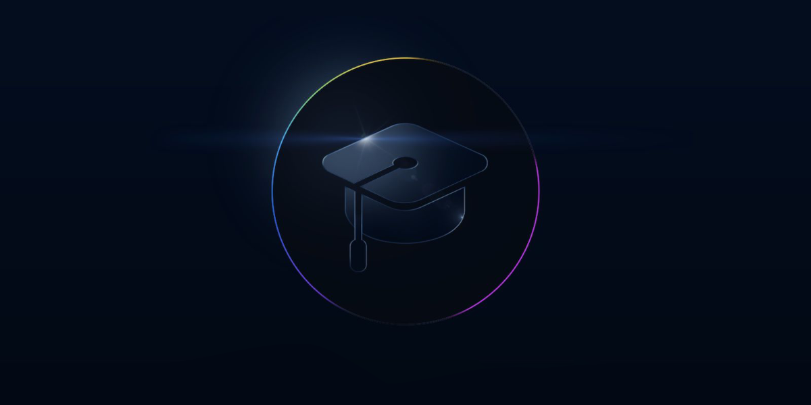

# WWDC 2022 - Swift Student Challenge

List of student submissions for the WWDC 2022 - Swift Student Challenge. The list is in alphabetical order.

### How to add your submission?
1. **[Click here to open the form](https://github.com/wwdc/2022/issues/new?template=submit.yml)** and fill it in.
2. Send it. A bot checks your entry within a minute and tells you if anything needs fixing. You can edit the form after sending.
3. When it is approved your entry appears on this list.

#### How to update or remove your submission?
Use the **[update form](https://github.com/wwdc/2022/issues/new?template=update.yml)**. Only the person who sent the entry can change it.

### Submissions

| Participant | Links  | Status                |
|:--|:--|:--|
| [Amber Wu](https://github.com/wyy511511) | [GitHub](https://github.com/wyy511511/HockeyTourWithBingDwenDwen) SwiftUI, ARKit, ARQuickLook |  |
| [Anatole Debierre](https://github.com/a2br) | [GitHub](https://github.com/a2br/vote) · [Video](https://www.youtube.com/watch?v=414azCHcAgk) SwiftUI |  |
| [Aryan Chaubal](https://github.com/chaubss) | [GitHub](https://github.com/chaubss/Turing-Machine-WWDC22) SwiftUI, AVFoundation |  |
| [Ataberk Turan](https://github.com/ataberkturan) | [GitHub](https://github.com/ataberkturan/ParkinsonAI) SwiftUI, Combine, CoreML, PencilKit |  |
| [Audrey Wang](https://github.com/audreyolaf) | [GitHub](https://github.com/audreyolaf/Theia) · [Video](https://youtu.be/bLVWnQGnx9s) SwiftUI, AVFoundation |  |
| [Ayush Singh](https://github.com/Ayush21082) | [GitHub](https://github.com/Ayush21082/Flip-The-Cup) · [Video](https://youtu.be/1zy_tqStrtA) SwiftUI, SceneKit, ARKit |  |
| [Bartłomiej Pluta](https://github.com/bpluta) | [GitHub](https://github.com/bpluta/Pwnground) SwiftUI, Combine |  |
| Bedir Ekim | [GitHub](https://github.com/BedirEkim/Securencrypt-WWDC22) SwiftUI, Vision |  |
| Berkin Ceylan | [GitHub](https://github.com/berkinceylan/WWDC22) SwiftUI, CoreML |  |
| [Bon Sung Koo](https://github.com/terry-koo) | [GitHub](https://github.com/terry-koo/WWDC_Colors_SwiftUI) SwiftUI |  |
| [Bryanza Novirahman](https://github.com/bryanzanr) | [GitHub](https://github.com/bryanzanr/drawer) · [Video](https://youtu.be/ZIRQrQKmxsQ) SwiftUI |  |
| [Byeon Jinha](https://github.com/Byeonjinha) | [GitHub](https://github.com/Byeonjinha/CooC_Archive) SwiftUI |  |
| [Carl Voller](https://www.linkedin.com/in/carl-ian-voller) | [GitHub](https://github.com/Portatolova/WWDC2022-Wholesome) SwiftUI, PencilKit, CoreML, NaturalLanguage |  |
| [Chema PF](https://github.com/clxsrdev) | [GitHub](https://github.com/clxsrdev/Mixin-UP) · [Video](https://youtu.be/qkMU5xHEZ_8) SwiftUI |  |
| [Chubo Han](https://github.com/soulwinter) | [GitHub](https://github.com/soulwinter/Genetics-Lab) · [Video](https://www.youtube.com/watch?v=-1Vt5Ta_dYw) SwiftUI |  |
| [Conrad Crawford](https://cnrad.dev) | [GitHub](https://github.com/cnrad/polyvisual) SwiftUI, AVFoundation |  |
| [Cynara Costa](https://www.linkedin.com/in/cynaracosta/) | [GitHub](https://github.com/CynaraCosta/graviNewton-WWDC22) · [Video](https://www.youtube.com/watch?v=kbO4dDJVx-A) SwiftUI, AVKit |  |
| [Daegun Choi](https://github.com/ChoiysApple) | [GitHub](https://github.com/ChoiysApple/Asteroids-Plus) · [Video](https://youtu.be/OffJ0KTX0mI) SwiftUI, SpriteKit |  |
| [David Mazzeo](https://github.com/TheIntelCorei9) | [GitHub](https://github.com/TheIntelCorei9/Swift-Student-Challenge) UIKit, SpriteKit |  |
| [Davin Djayadi](https://github.com/davindj) | [GitHub](https://github.com/davindj/cofi) SwiftUI, SceneKit, Combine |  |
| [Devanshu Dev Chaudhary](https://github.com/devdchaudhary) | [GitHub](https://github.com/devdchaudhary/A-Girls-Epiphany) SwiftUI, SpriteKit, Speech |  |
| [Diego Henrique Silva Oliveira](https://github.com/DiegoHSO) | [GitHub](https://github.com/DiegoHSO/DinnerRun.git) · [Video](https://youtu.be/OOMrZj_hsI8) SwiftUI |  |
| [Don Chia](https://donchia.tech) | [GitHub](https://github.com/DonChiaQE/ReGen) SwiftUI |  |
| [Eunbi Cho](https://github.com/Eunbi-Cho) | [GitHub](https://github.com/Eunbi-Cho/Feel-the) SwiftUI, SpriteKit |  |
| [Frank Chu](https://twitter.com/cyongfrank) | [GitHub](https://github.com/yongfrank/OhMyFlag-WWDC22) · [Video](https://twitter.com/cyongfrank/status/1518663840463872000) SwiftUI, CoreData, PencilKit, DocC |  |
| Fred P | [GitHub](https://github.com/fredpi/WWDC2022) SwiftUI, UIKit, CoreGraphics |  |
| [Furkan Hancı](https://github.com/furkanhancisecond) | [GitHub](https://github.com/FurkanHanciSecond/LearnSwiftUI) SwiftUI |  |
| [Gaeun Lee](https://github.com/rriver2) | [GitHub](https://github.com/rriver2/WWDC--Ep-) · [Video](https://www.youtube.com/watch?v=X5ij9X1Gq-A) SwiftUI, AVFoundation |  |
| [Garv Shah](https://github.com/garv-shah) | [GitHub](https://github.com/garv-shah/Swift-Student-Challenge-2022) SwiftUI, SceneKit, ARKit, Combine |  |
| [Geetansh Atrey](https://github.com/geetanshatrey) | [GitHub](https://github.com/geetanshatrey/Vault) SwiftUI, CryptoKit |  |
| [Haotian Zheng](https://haotianzheng.com/) | [GitHub](https://github.com/JustinFincher/WWDC2022-SwiftUINodeEditor) · [Video](https://youtu.be/B6D3y49WOEQ) SwiftUI, Combine, SpriteKit |  |
| [Henri Bredt](https://henribredt.de) | [GitHub](https://github.com/henribredt/Typography-WWDC22) · [Video](https://www.youtube.com/watch?v=AiK6CGgM71w) SwiftUI |  |
| [Hugo Queinnec](https://github.com/hugoqnc) | [GitHub](https://github.com/hugoqnc/Split) SwiftUI, Vision |  |
| [Hyunjun Shin](https://github.com/greenthings) | [GitHub](https://github.com/greenthings/GreenWorld) SwiftUI, SpriteKit |  |
| [Ishaan Bedi](https://github.com/ishaanbedi) | [GitHub](https://github.com/ishaanbedi/Chipify-WWDC22) · [Video](https://youtu.be/bWf6gNBQSB8) SwiftUI |  |
| [Jakub Florek](https://github.com/MAJKFL) | [GitHub](https://github.com/MAJKFL/Audioqe-WWDC22) · [Video](https://youtu.be/TnayjRjrYp8) SwiftUI, AVFoundation |  |
| [Jia Chen](https://github.com/jiachenyee) | [GitHub](https://github.com/jiachenyee/WWDC22-SSC) SwiftUI, UIKit, SceneKit, ARKit |  |
| [João Medeiros](https://github.com/jpcm2) | [GitHub](https://github.com/jpcm2/JungleRescue) SwiftUI, SpriteKit, AVFoundation |  |
| [Jonathan](https://github.com/fuzzynat26) | [GitHub](https://github.com/FuzzyNat26/build-with-math) SwiftUI, AVFoundation |  |
| [Ju DongSeok](https://github.com/MojitoBar) | [GitHub](https://github.com/MojitoBar/SpaceHash) SwiftUI, SpriteKit |  |
| [Juan Campos Jr.](https://github.com/PiggyGamingYT3) | [GitHub](https://github.com/PiggyGamingYT3/Unwind) SwiftUI, MapKit |  |
| [Juha Park](https://github.com/juhapark21) | [GitHub](https://github.com/juhapark21/WWDC22-DefaultAppsARGlasses) SwiftUI, RealityKit, ARKit |  |
| [Juhwa Lee](https://github.com/Juhwa-Lee1023) | [GitHub](https://github.com/Juhwa-Lee1023/Hangeul) SwiftUI, UIKit, AVFoundation |  |
| [Kaijun Zhu](https://kaijunzhu.com) | [GitHub](https://github.com/Heyya-x) SwiftUI, SpriteKit |  |
| [Karandeep Singh](https://sg.linkedin.com/in/karandeep-singh-635888213) | [GitHub](https://github.com/ConfuseIous/ASLearn) UIKit, SwiftUI, CoreML, AVKit |  |
| [Kasper Munch Jensen](https://github.com/KaffeDiem) | [GitHub](https://github.com/KaffeDiem/DrawBeatMaker) SwiftUI, AVFoundation, PencilKit |  |
| [Kenneth Chew](https://github.com/kthchew/) | [GitHub](https://github.com/kthchew/wwdc22-mystack) SwiftUI |  |
| Keshav Khaneja | [GitHub](https://github.com/3u1s/eoqe) SwiftUI, manim, AVPlayer, CGPaths |  |
| [Leon Böttger](https://github.com/leonboe1) | [GitHub](https://github.com/leonboe1/SortApp) SwiftUI |  |
| [Lexline Johnson](https://github.com/codeswift27) | [GitHub](https://github.com/codeswift27/quantum-entanglement.git) SwiftUI |  |
| [Lin Bo Rong](https://github.com/rong1002) | [GitHub](https://github.com/rong1002/2022WWDC_Swift-Student-Challenge_Burn-Calories) · [Video](https://www.youtube.com/watch?v=UTRDFw31SUA&t) SwiftUI |  |
| [Lu Jingyuan](https://github.com/Jimmyluluu) | [GitHub](https://github.com/Jimmyluluu/WWDC22-MusicLearning) SwiftUI |  |
| [Lucas Wang](https://github.com/Lucas-ZX-W) | [GitHub](https://github.com/Lucas-ZX-W/gaze_control) SwiftUI, ARKit |  |
| [Luiz Araujo](https://github.com/LuizAraujo2020) | [Video](https://youtu.be/VHeL9B65_gM) SwiftUI, SceneKit, SpriteKit, GameplayKit |  |
| [M. Bertan Tarakçıoğlu](https://medium.com/@bertan.tarakcioglu) | [GitHub](https://github.com/BertanT/BlinkBoard-WWDC22) SwiftUI, CoreAnimation, Vision |  |
| [Madhav Gulati](https://github.com/MadhavGulati/) | [GitHub](https://github.com/MadhavGulati/GeneCloning) · [Video](https://youtu.be/j0WaM1uHiiQ) SwiftUI, AVFoundation, ARKit, SpriteKit |  |
| [Matheus Dantas](https://github.com/dantoso) | [GitHub](https://github.com/dantoso/WWDC22Submission) SwiftUI, AVFoundation |  |
| [Matthew Christopher Albert](https://github.com/MatthewCAlbert) | [GitHub](https://github.com/MatthewCAlbert/wwdc2022-submission) SwiftUI, AVKit |  |
| Max Tsai | [GitHub](https://github.com/ming-zhe-02/The-Fake-News) · [Video](https://www.youtube.com/watch?v=scV6d8G3EZw) SwiftUI |  |
| [Minkyeong Ko](https://github.com/Minkyeong-Ko) | [GitHub](https://github.com/Minkyeong-Ko/Freeboard) · [Video](https://youtu.be/XXkhVd-ziIw) SwiftUI |  |
| Nathaniel Fargo | [GitHub](https://github.com/theParadox42/Waves) SwiftUI, Canvas, Math/Physics |  |
| [Omar Abusharar](https://github.com/omartheturtle/) | [GitHub](https://github.com/omartheturtle/SwiftStudentChallenge2022) SwiftUI, UIKit, SpriteKit, ARQuickLook |  |
| [Oscar Fridh](https://www.linkedin.com/in/oscar-fridh-03279b125/) | [GitHub](https://github.com/OscarFridh/WWDC22) · [Video](https://www.youtube.com/watch?v=Yvlz3F5ZXkg) ARKit, RealityKit, SwiftUI, UIKit |  |
| [Patricia Sampaio](https://github.com/patysiq) | [GitHub](https://github.com/patysiq/SagittariusA_WWDC2022) AVFoundation, SceneKit, SwiftUI, UIKit |  |
| [Paulo César](https://github.com/Nyffi) | [GitHub](https://github.com/Nyffi/WWDC22-SwiftStudentChallenge) SpriteKit, SwiftUI |  |
| [Peter Yaacoub](https://github.com/Yaacoub) | [GitHub](https://github.com/Yaacoub/Swift-Student-Challenge/tree/main/WWDC%202022) · [Video](https://youtu.be/t4NQSHLIbaw) AVFoundation, CoreGraphics, SwiftUI, UIKit |  |
| [Riccardo Persello](https://github.com/persello) | [GitHub](https://github.com/persello/ssc22) Accelerate, AVFoundation, SwiftUI |  |
| [Rido Hendrawan](https://github.com/ridohendrawan) | [GitHub](https://github.com/ridohendrawan/WWDC22-Chinese-Porcelain) SwiftUI |  |
| [Ryan Du](https://github.com/ryendu) | [GitHub](https://github.com/ryendu/GradientDescend) · [Video](https://www.youtube.com/watch?v=TINWpa961VE) SwiftUI, AVFoundation, SceneKit, CoreMotion |  |
| [Sam Poder](https://github.com/sampoder) | [GitHub](https://github.com/sampoder/whack-a-mole) SwiftUI |  |
| [Sascha Salles](https://github.com/saschasalles) | [GitHub](https://github.com/saschasalles/Athletic-Robot.swiftpm) ARKit, Vision, CreateML, AVFoundation |  |
| [Sérgio Ruediger](https://github.com/sruediger) | [GitHub](https://github.com/sruediger/WWDC2022CTF) SwiftUI, Combine, CoreGraphics, CryptoKit |  |
| [TaekhwanHan](https://github.com/TaekH) | [GitHub](https://github.com/TaekH/WWDC22_MedicineReminder) SwiftUI |  |
| [Tamerlan Satualdypov](https://github.com/onl1ner) | [GitHub](https://github.com/onl1ner/Morse) SwiftUI, AVFoundation |  |
| [Vedant Malhotra](https://github.com/vedantapps) | [GitHub](https://github.com/vedantapps/SaveWWDC) · [Video](https://youtu.be/um2HbaI8xqA) SwiftUI, UIKit, ARKit, PencilKit |  |
| [Vincent Spitale](https://github.com/vincentspitale) | [GitHub](https://github.com/vincentspitale/SSC2022) · [Video](https://youtu.be/vQM8yTbGguQ) SwiftUI, PencilKit, VisionKit, MetalKit |  |
| [Vitor Grechi Kuninari](https://www.wwdcscholars.com/s/32CD09B0-46A3-4D89-A10F-AF9984766715) | [GitHub](https://github.com/VitorGK/WWDC22-Swift-Student-Challenge) SwiftUI, SpriteKit |  |
| [Xikai Liu](https://github.com/iamGeoWat) | [GitHub](https://github.com/iamGeoWat/WWDC22) · [Video](https://www.bilibili.com/video/BV1W34y1p7M3/) SwiftUI |  |
| [Yaoyao Wu](https://github.com/wyy511511) | [GitHub](https://github.com/wyy511511/HockeyTourWithBingDwenDwen) SwiftUI, ARKit, ARQuickLook |  |
| Yauheni Stsefankou | [GitHub](https://github.com/stefjen07/WWDC22-NeuralNetworks) SwiftUI, SpriteKit, CoreGraphics |  |
| [Yiwei Wang](https://github.com/wangyiwei2015) | [GitHub](https://github.com/wangyiwei2015/ColorCodeChallenge) SwiftUI |  |
| [Yunho Oh](https://github.com/Helloyunho) | [GitHub](https://github.com/Helloyunho/about_computer_bits) · [Video](https://youtu.be/V8Zhc-dDbVI) SwiftUI |  |
| Zhu Haoyu | [GitHub](https://github.com/underthestars-zhy/Date-Planner.swiftpm) · [Video](https://www.bilibili.com/video/BV18Y4y187Gj/) SwiftUI, ARKit, Speech, UIKit +1 |  |

##### Total: 83 | Awarded: 71
